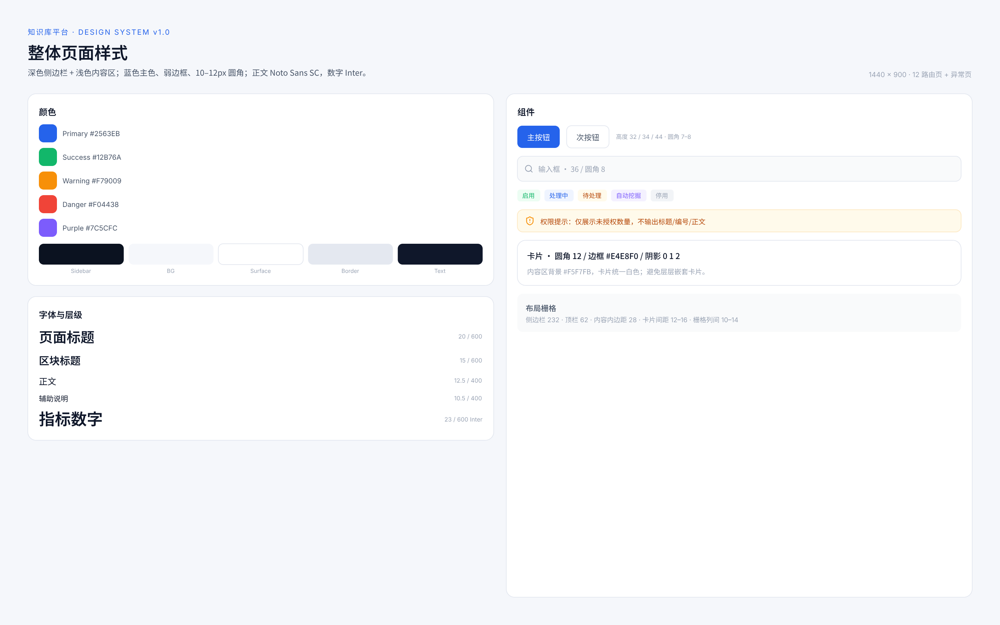

# 设计规范（Design System）

知识库管理平台前端的整体视觉与组件规范。来源：pen.dev 原型画布与 `frontend/src/styles/tokens.css`。



## 1. 设计基调

- 深色侧边栏 + 浅色内容区，强调“企业后台 + 知识工作台”的克制感。
- 主色蓝，语义色只用于状态与权限提示；不使用大面积渐变与重阴影。
- 卡片圆角 10–12px、弱边框 `#E4E8F0`，避免层层嵌套卡片。
- 中文正文 Noto Sans SC，数字与编号 Inter。

## 2. 颜色

| Token | 值 | 用途 |
|---|---|---|
| `--kb-primary` | `#2563EB` | 主按钮、链接、选中态、进度 |
| `--kb-primary-soft` | `#EFF4FF` | 选中背景、提示块、索引徽标 |
| `--kb-success` | `#12B76A` | 启用、已完成、已同步 |
| `--kb-success-soft` | `#ECFDF3` | 成功标签背景 |
| `--kb-warning` | `#F79009` | 待处理、权限提示、OCR 风险 |
| `--kb-warning-soft` | `#FFFAEB` | 警告块背景 |
| `--kb-danger` | `#F04438` | 失败、删除、停用 |
| `--kb-danger-soft` | `#FEF3F2` | 危险标签背景 |
| `--kb-purple` | `#7C5CFC` | 部门、角色、知识热度 |
| `--kb-purple-soft` | `#F4F1FF` | 紫色标签背景 |
| `--kb-sidebar` | `#0B1220` | 侧边栏、登录左侧品牌区 |
| `--kb-sidebar-hover` | `#16213A` | 侧边栏悬停 |
| `--kb-bg` | `#F5F7FB` | 内容区背景 |
| `--kb-surface` | `#FFFFFF` | 卡片、顶栏 |
| `--kb-border` | `#E4E8F0` | 卡片/表格/输入框边框 |
| `--kb-text` | `#0F172A` | 主文本 |
| `--kb-text-2` | `#475467` | 次要文本 |
| `--kb-text-3` | `#98A2B3` | 辅助说明、占位符 |

## 3. 字体与层级

| 场景 | 字体 | 字号 | 字重 | 行高 |
|---|---|---|---|---|
| 页面标题 | Noto Sans SC | 20 | 600 | 1.3 |
| 区块标题 | Noto Sans SC | 14–15 | 600 | 1.4 |
| 卡片标题 | Noto Sans SC | 12–13 | 600 | 1.4 |
| 正文 | Noto Sans SC | 12.5 | 400 | 1.6–1.75 |
| 辅助说明 | Noto Sans SC | 9.5–10.5 | 400 | 1.5 |
| 指标数字 | Inter | 22–24 | 600 | 1.1 |
| 单元编号/时间 | Inter | 9–11 | 400 | 1.3 |

## 4. 间距、圆角与阴影

- 间距刻度：4 / 6 / 8 / 10 / 12 / 14 / 16 / 18 / 22 / 28 / 40。
- 圆角：按钮 7–8，输入框 8，标签 4–5，卡片 10–12，弹窗 14–16。
- 阴影：仅卡片使用 `0 1px 2px rgba(16,24,40,.04)`；不用大投影。
- 布局：侧边栏 232px；顶栏 62px；内容内边距 28px；卡片间距 12–16px；栅格列间距 10–14px。

## 5. 组件规范

### 按钮

| 类型 | 高度 | 背景 | 文本 | 边框 |
|---|---|---|---|---|
| 主按钮 | 32 / 34 / 44 | `--kb-primary` | `#FFFFFF` | 无 |
| 次按钮 | 32 / 34 | `--kb-surface` | `--kb-text-2` | `--kb-border` 1px |
| 文字按钮 | 自适应 | 透明 | `--kb-primary` | 无 |

### 输入框

- 高度 34–44，圆角 8，背景 `#F9FAFB`，1px 边框。
- 聚焦：边框变为主色；错误态使用危险色。
- 搜索框左侧放 13–14px 线性图标。

### 标签 / 徽标

- 圆角 4–5，字号 9–9.5，内边距 `2px 6–7px`。
- 语义：成功、处理中、待处理、自动挖掘、停用；同一表格内最多 2–3 个标签，多余用 `+n`。

### 卡片

- 白底、12px 圆角、1px 边框；标题 12.5/600。
- 卡片内不再嵌套卡片；分区用分割线或浅灰块 `#F9FAFB`。

### 表格

- 表头 10.5/500、`--kb-text-3`，背景 `#F9FAFB`，行高 46–54。
- 列优先使用接口字段：编号、标题、分类、格式、权限摘要、创建人、更新时间、状态、操作。
- 状态与权限用标签；长文本单行省略，第二行放次要信息。

### 侧边栏

- 宽度 232，深色底；分组标题 10.5px、`#475569`，字母间距 1px。
- 菜单项高 38，圆角 8；选中 `#1E293B` + 白字；图标 17px。
- 底部用户卡：头像 32、姓名 12.5、角色 10.5；右侧登出按钮。

### 权限提示

- 只显示数量：“另有 N 个相关知识单元因权限限制未展示”。
- 使用 warning-soft 背景 + 盾牌图标；不显示未授权单元的标题、编号、正文。
- FAQ ACL 提示使用 primary-soft 背景，明确“继承关联单元、取交集、命中仍校验”。

## 6. 页面骨架

```
┌────────────┬──────────────────────────────────────────┐
│ Sidebar    │ Topbar 62px（面包屑 / 搜索 / 通知 / 头像）│
│ 232px      ├──────────────────────────────────────────┤
│ 分组导航    │ Content（padding 28，bg #F5F7FB）          │
│ 用户卡      │ 页面标题 + 副标题 + 操作按钮                │
│            │ 指标卡 / 筛选 / 表格 / 图表 / 空状态         │
└────────────┴──────────────────────────────────────────┘
```

登录页例外：左侧 600px 深色品牌区（Logo、主张、三条能力），右侧白色表单区居中 392px。

## 7. 交互与状态

- 加载：按钮 loading；页面级骨架屏；表格空状态。
- 错误：表单内联错误优先于全局 Toast；接口错误统一 `{code, message}`。
- 删除/停用：二次确认；危险操作按钮使用危险色。
- 权限：菜单按 `menu:*` 渲染；按钮按动作权限显示/禁用；路由守卫不足跳 403。
- SSE：`meta → delta* → usage → done`；断线提示、手动停止、失败降级。
- Markdown：markdown-it + DOMPurify，禁止原始 HTML。

## 8. 文件

| 文件 | 内容 |
|---|---|
| `docs/design/style-board.png` | 设计规范总览图 |
| `docs/design/style-board.html` | 设计规范 HTML 快照 |
| `docs/design/design-tokens.json` | 机器可读 token |
| `frontend/src/styles/tokens.css` | 前端实际使用的 CSS 变量（唯一实现来源） |
| `docs/design/frontend-prototype.html` | 全页面原型 |
| `docs/design/screens/*.png` | 逐屏截图 |

## 9. 维护规则

1. 修改颜色/字体/圆角时，先改 `frontend/src/styles/tokens.css`，再同步本文件与 `design-tokens.json`。
2. 新增页面必须复用现有 token 与组件，不引入第二套主色或圆角体系。
3. 原型（pen）变更后，重新导出 `frontend-prototype*.html`、`screens/*.png` 与本规范图。
